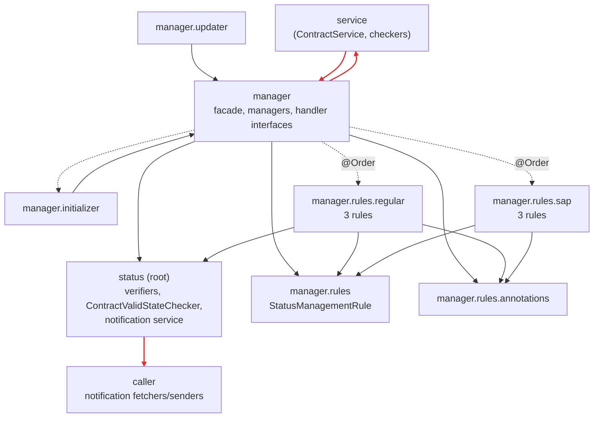

# Package Dependency Diagram: `service.contract.status`

Module `service.contract.status` in `cm_sf_report` (35 classes). Package names omit the `service.contract.status` prefix.

## Diagram

Solid: compile-time dependency (`import`). Dashed: runtime dependency wired by Spring (injected lists, `@Order`). Red: the cycle and the SDP violation.

## Metrics

I = Ce / (Ca + Ce), A = abstract types / all types, D = |A + I − 1|. Only project classes counted; annotations count as abstract.

| Package | Classes | Ca | Ce | I | A | D |
|---------|---------|----|----|---|---|---|
| *(root)* | 8 | 4 | 7 | 0.64 | 0.13 | 0.24 |
| `caller` | 6 | 1 | 6 | 0.86 | 0.33 | 0.19 |
| `manager` | 10 | 7 | 10 | 0.59 | 0.50 | 0.09 |
| `manager.initializer` | 1 | 0 | 1 | 1.00 | 0 | 0 |
| `manager.updater` | 1 | 1 | 1 | 0.50 | 0 | 0.50 |
| `manager.rules` | 1 | 9 | 1 | 0.10 | 1 | 0.10 |
| `manager.rules.annotations` | 2 | 8 | 0 | 0.00 | 1 | 0 |
| `manager.rules.regular` | 3 | 0 | 3 | 1.00 | 0 | 0 |
| `manager.rules.sap` | 3 | 0 | 3 | 1.00 | 0 | 0 |

## Findings
- **Cycle (ADP): `service` ⇄ `status.manager`.** `ContractService` calls the facade, and the managers call `ContractServicePackageChecker` and `CurrentUserPermissionChecker` in `service`. Fix: managers depend on small interfaces owned by `status.manager` (DIP).
- **SDP violation: root (0.64) → `caller` (0.86).** Root depends on notification plumbing only because the notification service lives there (also a CCP problem). Fix: move the notification service and `caller` into their own package.
- **SAP done right:** `manager.rules` is stable and abstract, and the concrete rules are unstable leaves. No package is in the zone of pain or the zone of uselessness.
- **Hidden coupling:** the dashed arrows. Rule order comes from `@Order` numbers spread across files, which imports don't show (see the [critique](../essays/01-design-critique.md), finding 2).

## How I measured
Grepped project imports in every class of the module and imports of the module from the rest of the codebase; same-package use checked by reading the code. Nested types count with their outer class.
