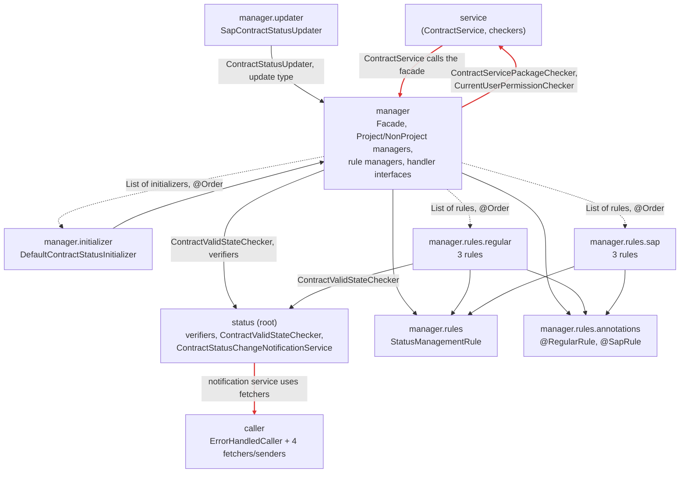

# Package Dependency Diagram: `service.contract.status`

Module: `se.ericsson.internal.csdp.cmgateway.service.contract.status` in `cm_sf_report` (35 classes, about 1,100 lines). It decides a contract's status (Draft / Open), verifies status transitions, and sends status-change reminder emails. Package names below omit the `service.contract.status` prefix.

## Diagram

Solid arrow: compile-time dependency (`import`). Dashed arrow: runtime dependency wired by Spring (list injection, `@Order`). Red: the cycle and the SDP violation called out below.

## Metrics

- **Ca** (afferent): classes outside the package that depend on classes inside it
- **Ce** (efferent): classes inside the package that depend on classes outside it
- **I** = Ce / (Ca + Ce): 0 = maximally stable, 1 = maximally unstable
- **A** = abstract classes and interfaces / total classes
- **D** = |A + I − 1|: distance from the main sequence (0 is ideal)

| Package | Classes | Ca | Ce | I | A | D | Notes |
|---------|---------|----|----|---|---|---|-------|
| *(root)* | 8 | 4 | 7 | 0.64 | 0.13 | 0.24 | Mixes status verification with the notification service |
| `caller` | 6 | 1 | 6 | 0.86 | 0.33 | 0.19 | Only used by the notification service |
| `manager` | 10 | 7 | 10 | 0.59 | 0.50 | 0.09 | Balanced: 4 interfaces + 1 abstract class |
| `manager.initializer` | 1 | 0 | 1 | 1.00 | 0 | 0 | Leaf, wired by Spring |
| `manager.updater` | 1 | 1 | 1 | 0.50 | 0 | 0.50 | Concrete, yet `CostCollectorRefresher` depends on it |
| `manager.rules` | 1 | 9 | 1 | 0.10 | 1 | 0.10 | Stable abstraction: everyone depends on the interface |
| `manager.rules.annotations` | 2 | 8 | 0 | 0.00 | 1 | 0 | Qualifier annotations, counted as abstract |
| `manager.rules.regular` | 3 | 0 | 3 | 1.00 | 0 | 0 | Leaf rules, wired by Spring |
| `manager.rules.sap` | 3 | 0 | 3 | 1.00 | 0 | 0 | Leaf rules, wired by Spring |

**What works well:** the rule hierarchy follows the Stable Abstractions Principle. `manager.rules` is stable and abstract, and the concrete rules are unstable leaves that nothing depends on at compile time. A new rule is a new class; nothing else changes.

## Cycles found (ADP)
| Cycle | Classes causing it | How to break it |
|-------|--------------------|-----------------|
| `service` ⇄ `status.manager` | `ContractService`, `ExpiredStatusOverrideCommentRemovalJob` → `ContractStatusManagerFacade`; `NonProjectContractStatusManager`, `ProjectContractStatusManager` → `ContractServicePackageChecker`, `CurrentUserPermissionChecker` (both in `service`) | Move the two checkers out of the flat `service` package (e.g. into `service.contract`), or let the managers depend on small interfaces defined in `status.manager` and implemented in `service` (DIP) |

No cycles inside the module itself.

## SDP / SAP violations
- **Stable package depending on a less stable one (SDP): root (I = 0.64) → `caller` (I = 0.86).** The root package depends on notification plumbing only because `ContractStatusChangeNotificationService` lives there. Status verification and reminder emails change for different reasons, so this is also a Common Closure Principle problem. **Fix:** move the notification service and `caller` into their own package (e.g. `status.notification`); root then no longer depends on `caller`.
- **Stable but concrete (zone of pain):** none. The worst D is `manager.updater` (0.50), a single concrete class with one outside user.
- **Unstable but abstract (zone of uselessness):** none.

## Hidden runtime coupling (dashed lines)
The imports don't show everything. The managers receive their rules, handlers and initializers as Spring-injected lists, and the **order** comes from `@Order` numbers scattered across the rule classes. `FinInfoRule` (`@Order(1)`) sets a draft date that `StatusTransitionRule` (`@Order(2)`) reads, so renumbering one class silently changes behaviour. That is connascence of execution order across files, covered in the [design critique](../essays/01-design-critique.md).

## How I measured
- Grepped `import se.ericsson.internal.csdp...` lines in every class of the module, plus imports of the module from the rest of `src/main/java`.
- Counted only project classes; JDK, Spring, Lombok and MapStruct are excluded. Nested types (e.g. `ContractStatusUpdateType` inside the facade) count as part of their outer class.
- Same-package references without imports were checked by reading the code.
