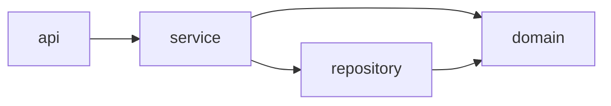

# Package Dependency Diagram: <module name>

## Diagram

## Metrics

- **Ca** (afferent): number of classes outside the package that depend on classes inside it
- **Ce** (efferent): number of classes inside the package that depend on classes outside it
- **I** = Ce / (Ca + Ce): 0 = maximally stable, 1 = maximally unstable
- **A** = abstract classes and interfaces / total classes
- **D** = |A + I − 1|: distance from the main sequence (0 is ideal)

| Package | Ca | Ce | I | A | D | Notes |
|---------|----|----|---|---|---|-------|
| | | | | | | |

## Cycles found (ADP)
| Cycle | Classes causing it | How to break it (DIP / new package / move class) |
|-------|--------------------|--------------------------------------------------|
| | | |

## SDP / SAP violations
- Stable package depending on an unstable one:
- Stable but concrete (zone of pain):
- Unstable but abstract (zone of uselessness):

## How I measured
<!-- e.g. IntelliJ Dependency Matrix, jdeps, JDepend, ArchUnit, manual count -->
