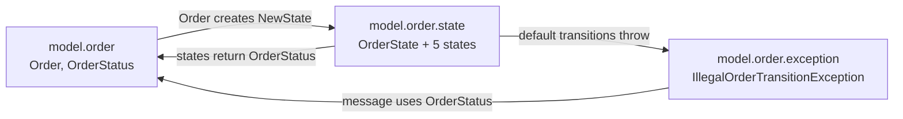

# Week 01: Design principles beyond SOLID + ShopFlow kickoff

## Three key ideas
1.
2.
3.

## What I'd do differently in my current project

## Questions for my mentor

## Where I disagree with the reading, and why

## ShopFlow design notes

### Packaging: by feature inside the model layer
The top level is split by layer (`model`, `service`). Inside `model`, classes are grouped by feature (`model.order`, and later `model.pricing` and `model.payment`). Within the order feature, they are further split by kind (`state`, `exception`).

### Accepted package cycle in `model.order` (ADP trade-off)

- **Cycles:** `order ⇄ state` and `order → state → exception → order`
- **Decision:** accept it. The cycle stays inside one feature, so it's tolerated within a feature but must not appear between features.
- **Cost:** the state classes had to become `public`, so code outside the package can create states. The three sub-packages can't be understood or changed independently.
- **If it starts to hurt:** move `OrderStatus` (and the exception) into `order.state`, or into a small shared base package, so all dependencies point one way.

---

## Prepare for the session
- **Which GRASP principle explains why a `Controller` shouldn't contain business logic?**
  -
- **Which kinds of connascence are hardest to spot, and how do they show up across module or service boundaries?**
  -
- **Which package in my module breaks the Stable Dependencies or Stable Abstractions principle, and what would fixing it cost?**
  -
- **In the ShopFlow kickoff, where did I choose *not* to use a pattern, and why?**
  -

## Reading log
- [ ] *Clean Architecture*: Part IV (Component Principles)
- [ ] *Applying UML and Patterns*: Ch. 17, 18, 25 (GRASP)
- [ ] connascence.io: full taxonomy
- [ ] M. Fowler: "TellDontAsk"
- [ ] M. Fowler: "AnemicDomainModel"

## Deliverables
- [ ] Design critique: [docs/essays/01-design-critique.md](../docs/essays/01-design-critique.md)
- [ ] Package dependency diagram: [docs/diagrams/01-package-dependencies.md](../docs/diagrams/01-package-dependencies.md)
- [ ] ShopFlow domain kickoff: [shopflow/README.md](../shopflow/README.md)
