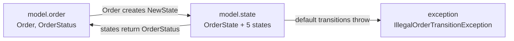

# Week 01: Design principles beyond SOLID + ShopFlow kickoff

## Three key ideas
1.
2.
3.

## What I'd do differently in my current project

## Questions for my mentor

## Where I disagree with the reading, and why

## ShopFlow design notes

### Packaging: traditional layers with sub-packages
- **First version:** by feature inside the model layer (`model.order`, `model.pricing`, `model.payment`, ...).
- **Now:** regrouped into classic layers to make the structure easier to follow: `model` (with `order`, `customer`, `money`, `payment`, `state` and `discount` sub-packages), `service`, `exception`, `integration` (payment gateway + adapters + factory), and `external` (pretend SDKs).
- **Trade-off:** a feature like payments is now spread across `model`, `exception`, `integration` and `service`, which goes against the Common Closure Principle. The `PaymentGateway` interface moved out of `model`, so `service` depends on `integration` (classic N-Tier) instead of on an interface the domain owns (Separated Interface).

### Accepted package cycle (ADP trade-off)

- **Cycle broken across layers:** `IllegalOrderTransitionException` used to take an `OrderStatus`, which made a cycle `model.order → model.state → exception → model.order` across layers. It now takes a plain `String` status, so `exception` depends on nothing in `model`.
- **Remaining cycle:** `model.order ⇄ model.state`. Accepted, because both packages belong to the order lifecycle inside the model layer.
- **Cost:** the state classes have to be `public`, so code outside the package can create states. `model.order` and `model.state` can't be understood or changed independently.
- **If it starts to hurt:** move `OrderStatus` into `model.state`, so all dependencies point one way.

---

## Prepare for the session
- **Which GRASP principle explains why a `Controller` shouldn't contain business logic?**
  -
- **Which kinds of connascence are hardest to spot, and how do they show up across module or service boundaries?**
  -
- **Which package in my module breaks the Stable Dependencies or Stable Abstractions principle, and what would fixing it cost?**
  -
- **In the ShopFlow kickoff, where did I choose *not* to use a pattern, and why?**
  -

## Reading log
- [ ] *Clean Architecture*: Part IV (Component Principles)
- [ ] *Applying UML and Patterns*: Ch. 17, 18, 25 (GRASP)
- [ ] connascence.io: full taxonomy
- [ ] M. Fowler: "TellDontAsk"
- [ ] M. Fowler: "AnemicDomainModel"

## Deliverables
- [ ] Design critique: [docs/essays/01-design-critique.md](../docs/essays/01-design-critique.md)
- [ ] Package dependency diagram: [docs/diagrams/01-package-dependencies.md](../docs/diagrams/01-package-dependencies.md)
- [ ] ShopFlow domain kickoff: [shopflow/README.md](../shopflow/README.md)
